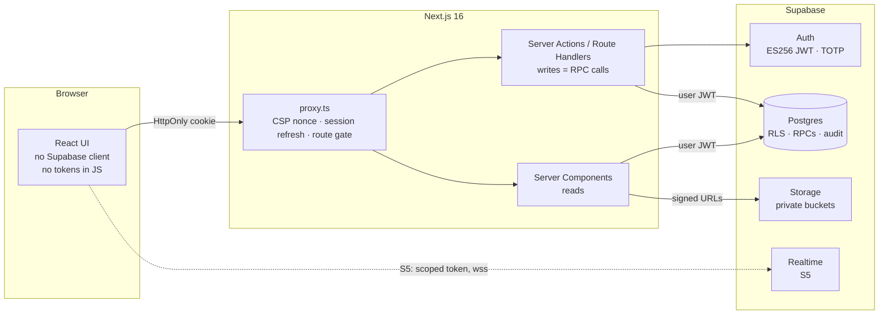
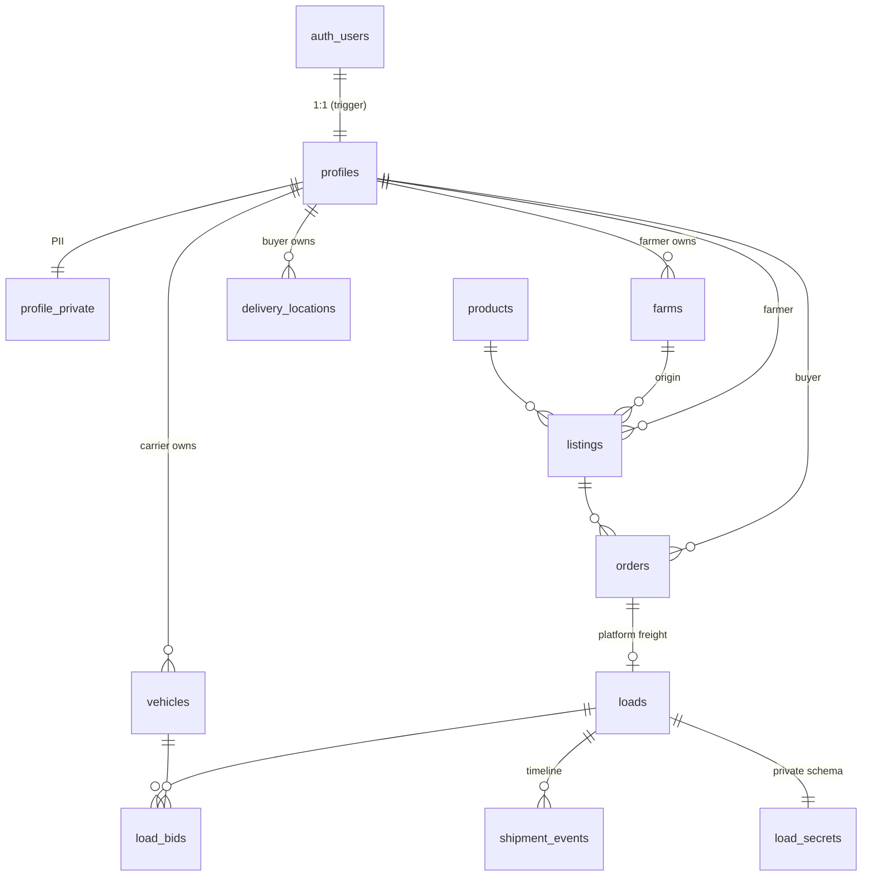

# Architecture

## Overview



The browser only ever talks to our Next.js server. Next.js talks to Supabase **as the signed-in user**, so every query goes through RLS. There is no service-role key in the web app.

## Repository layout

```
src/
  proxy.ts                  CSP nonce, session refresh, route gate (Next 16 "proxy" = old middleware)
  app/
    page.tsx                landing (public)
    (auth)/                 login, signup + server actions
    auth/confirm|signout    email-link verification, POST sign-out
    (app)/                  signed-in shell: farmer/, market/, buyer/, loads/, trips/, vehicles/, account/, admin/
    legal/                  privacy (Ley 1581), terms
    api/csp-report          CSP violation sink
  components/ui|shell       design system and navigation
  lib/
    auth/access.ts          route matrix (pure, unit-tested)
    auth/viewer.ts          getViewer() / requireRole() via getClaims()
    supabase/server.ts      per-request SSR client with hardened cookies
    security/               csp, cookies, safe redirects
    format/                 COP, kg, dates, DANE municipalities
supabase/
  config.toml               local stack: auth hardening, MFA, JWT hook, email templates
  migrations/               0100 foundation → 0600 audit/storage/catalog
  tests/database/           pgTAP: RLS and state machines
  templates/                auth emails (token_hash flow)
docs/                       requirements, architecture, security, routes, design, specs
scripts/                    signing key, GitHub issue import
```

## Data model



| Table | Who reads | Who writes |
|---|---|---|
| `profiles` | any signed-in user (public-safe columns only) | owner: `display_name`, `business_name`, `municipality_code`. Role/verification/rating: RPCs only |
| `profile_private` | owner, MFA admin | owner while unverified/rejected; `get_order_contacts()` exposes phones to live counterparties |
| `products` | everyone, including anonymous | migrations / admin (S2-01) |
| `farms`, `delivery_locations` | owner, MFA admin | owner |
| `vehicles` | owner, MFA admin | owner (edits send it back to review); `admin_review_vehicle()` |
| `listings` | published + in window: any signed-in user; all: owner, admin | owner, guarded by `listings_guard` trigger; stock changes only via order RPCs |
| `orders` | buyer, farmer, admin | RPCs only |
| `loads` | shipper, farmer, booked carrier, admin; `posted` loads: verified carriers | RPCs only |
| `load_bids` | the bidding carrier, the load's shipper, admin | RPCs only |
| `shipment_events` | load parties, admin | RPCs only |
| `private.load_secrets` | nobody (RPCs only) | RPCs only |
| `audit_log` | MFA admin | triggers only, immutable |

Conventions: UUID primary keys, `timestamptz` everywhere, money `bigint` COP, weight `numeric(12,2)` kg, municipalities as 5-digit DANE codes, `updated_at` maintained by trigger.

## Decisions (ADRs)

Short form. Each is a decision we stand by until a PR replaces it.

**ADR-001 · Next.js 16 + Supabase Postgres, AWS later.** Supabase gives us Postgres, Auth, Storage and Realtime with a local Docker stack today. Business rules live in plain Postgres (constraints, RLS, plpgsql), which moves to RDS/Aurora unchanged. The Supabase-specific parts are `auth.uid()` / `auth.jwt()` and Storage policies; when we move, those become a small compatibility schema reading claims from `request.jwt.claims`, and S3 replaces Storage.

**ADR-002 · Backend-for-frontend, no browser Supabase client.** Tokens never reach JavaScript, cookies are HttpOnly, the CSP can stay at `connect-src 'self'`, and the API surface we expose is our server, not PostgREST. Cost: realtime needs a scoped token handed to the browser in S5-03, and we accept that one exception.

**ADR-003 · Lifecycle changes are SECURITY DEFINER RPCs.** One function per transition, which validates actor and state, locks rows and writes. Clients cannot `insert/update` orders, loads or bids at all. The state machine is enforced in one place and is testable with pgTAP.

**ADR-004 · Money is integer COP.** No floats. Totals are computed by the database from snapshotted prices.

**ADR-005 · Strict nonce CSP, so every page renders dynamically.** We lose static rendering and PPR. For a signed-in marketplace that's fine; the landing can move to a separate static build with hash-based CSP if SEO speed ever needs it.

**ADR-006 · Location privacy by default.** Municipality only until a carrier is booked; exact stops only during the trip. This shapes the load board UI (lane by municipality, distance estimate, no pin).

**ADR-007 · Handoff codes instead of signatures.** A 6-digit code read aloud works over a phone call with no data, needs no hardware, and leaves an audit trail. Brute force is capped at 5 tries per load.

**ADR-008 · One role per account.** Simpler RLS, simpler navigation. If farmers who also haul become common (Q3 in REQUIREMENTS), we add organizations with members and roles instead of multi-role users.

**ADR-009 · Asymmetric JWT signing (ES256).** Tokens can be verified anywhere from the public JWKS without sharing a secret, which also keeps the AWS path open.

## Scaling notes

- Load board and market queries hit partial indexes on `status = 'published' / 'posted'`. Add PostGIS when we need radius search (S4-06).
- Housekeeping (`private.expire_stale()`) runs on `pg_cron` every 15 minutes (S3-05).
- Notifications (S3-06) go through an outbox table processed by a worker, so a slow email provider never blocks an RPC.
- When traffic justifies it: read replicas for the market, Supavisor transaction pooling, and CDN caching for the public landing.
