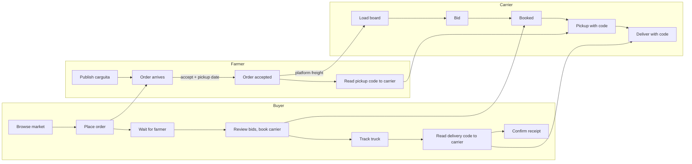

# Routes and navigation

Route rules are code in `src/lib/auth/access.ts` and tested in `src/__tests__/access.test.ts`. Keep this table and that file in sync.

UI copy is Spanish (es-CO). Paths are English so code, routes and tables use the same words.

## Route map

Legend: **P** public · **S** any signed-in user · **F** farmer · **B** buyer · **C** carrier · **A** admin (with MFA, `aal2`)

### Public

| Path | Access | Screen | Spec |
|---|---|---|---|
| `/` | P (signed-in users go to their home) | Landing | S0-05 |
| `/login` | P | Email + password | S1-01 |
| `/signup?role=` | P | Role picker + account form | S1-01 |
| `/forgot-password` | P | Request reset email | S1-07 |
| `/auth/confirm` | P | Verifies email link token, sets session | S1-01 |
| `/auth/signout` | S, `POST` only | Ends session | S1-01 |
| `/legal/privacy`, `/legal/terms` | P | Ley 1581 policy, terms | S0-07 |

### Farmer · tabs: Inicio · Mis carguitas · Pedidos · Cuenta

| Path | Access | Screen | Spec |
|---|---|---|---|
| `/farmer` | F | Today: orders to answer, pickups, active carguitas | S3-02 |
| `/farmer/listings` | F | My carguitas with status | S2-02 |
| `/farmer/listings/new` | F | Publish (product, kg, price, dates, photos) | S2-02 |
| `/farmer/listings/[id]` | F | Edit, withdraw, see orders on it | S2-02 |
| `/farmer/orders` | F | Inbox: accept (with pickup date) or reject | S3-02 |
| `/farmer/orders/[id]` | F | Order, freight status, pickup code | S3-02, S5-02 |
| `/farmer/farms` | F | Farms (exact location, private) | S1-04 |
| `/market` | F, B, A | Farmers can see market prices to price well | S2-03 |

### Buyer · tabs: Mercado · Pedidos · Entregas · Cuenta

| Path | Access | Screen | Spec |
|---|---|---|---|
| `/market` | B | Browse and filter carguitas | S2-03 |
| `/market/[id]` | B | Detail + place order | S2-04, S3-01 |
| `/buyer/orders` | B | My orders | S3-03 |
| `/buyer/orders/[id]` | B | Order, carrier bids, booking, tracking, delivery code, confirm receipt | S3-03, S4-03, S5-03 |
| `/buyer/locations` | B | Delivery points | S1-04 |

### Carrier · tabs: Fletes · Mis viajes · Vehículos · Cuenta

| Path | Access | Screen | Spec |
|---|---|---|---|
| `/loads` | C (verified to see data) | Load board, filters by lane, date, body, weight | S4-01 |
| `/loads/[id]` | C | Load detail + bid | S4-02 |
| `/trips` | C | Booked and active trips | S5-01 |
| `/trips/[id]` | C | Stops, navigation, enter pickup/delivery code, share location, POD photo | S5-01 to S5-04 |
| `/vehicles` | C | Vehicles and documents | S1-04 |

### Everyone signed in

| Path | Access | Screen | Spec |
|---|---|---|---|
| `/account` | S | Profile, verification status, sign out | S1-02 |
| `/account/verification` | S | Submit identity documents | S1-02 |
| `/account/security` | S | TOTP enrollment, step-up to `aal2`, sign out everywhere | S1-05 |

### Admin · tabs: Panel · Verificar · Mercado · Cuenta

| Path | Access | Screen | Spec |
|---|---|---|---|
| `/admin` | A | KPIs, alerts | S7-03 |
| `/admin/verifications` | A | People and vehicles waiting for review | S1-03 |
| `/admin/disputes` | A | Disputes | S7-02 |
| `/admin/audit` | A | Audit log viewer | S7-03 |

## Gates, in order

1. **`src/proxy.ts`** verifies the JWT, then applies `resolveAccess()`: anonymous users go to `/login?next=…`, users in the wrong area go to their role home, admins without `aal2` go to `/account/security?next=…`.
2. **`requireRole()`** at the top of every page in `(app)`. If the proxy matcher is ever misconfigured, the page still refuses.
3. **Postgres** decides what data comes back. A page that renders for the wrong person still shows nothing, because RLS returns no rows.

## Main flows

## Navigation rules

- Mobile: bottom tab bar, 4 tabs per role, account always last. Desktop (md and up): left sidebar with the same items.
- Detail screens push on top of their tab. Back goes to the list, keeping filters in the URL (`?product=banano&from=05045`).
- Every list has an empty state that says what to do next, never just "no data".
- The verification banner sits on top of every signed-in screen until the user is verified.
