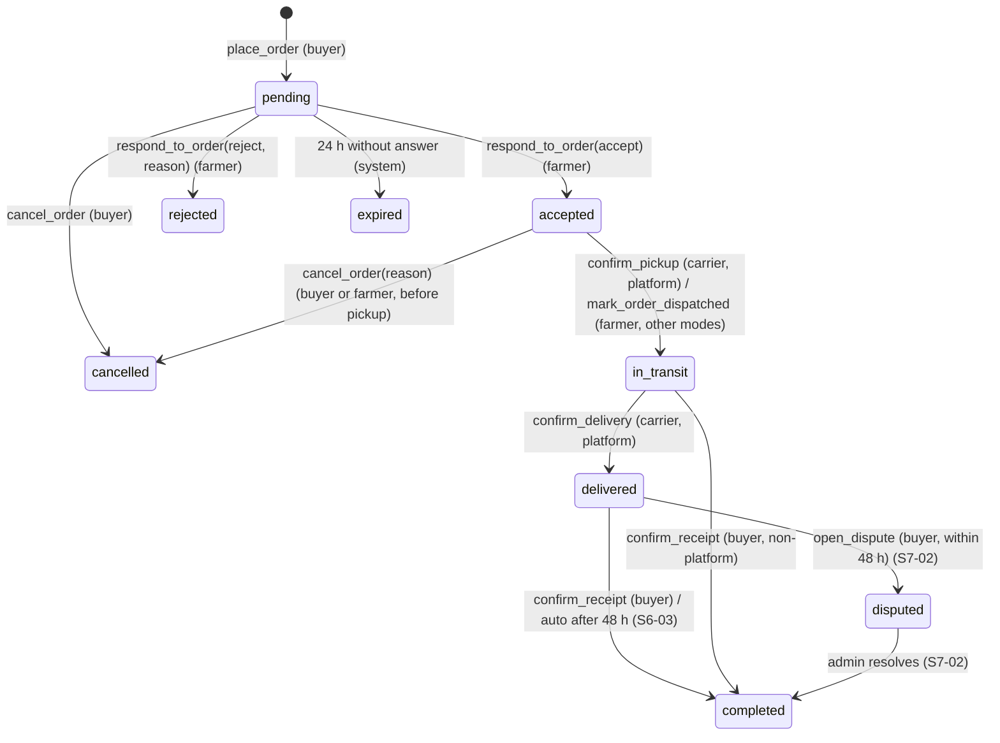
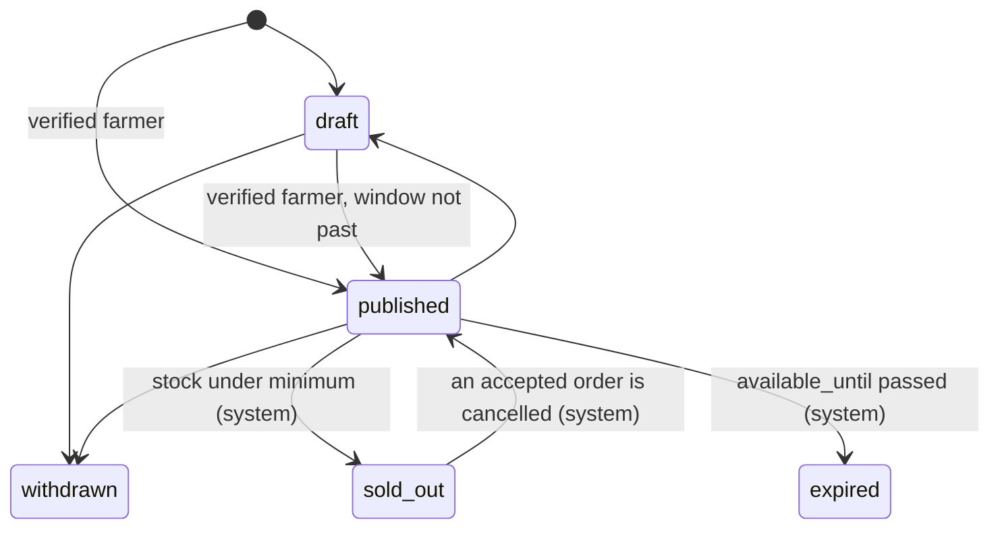
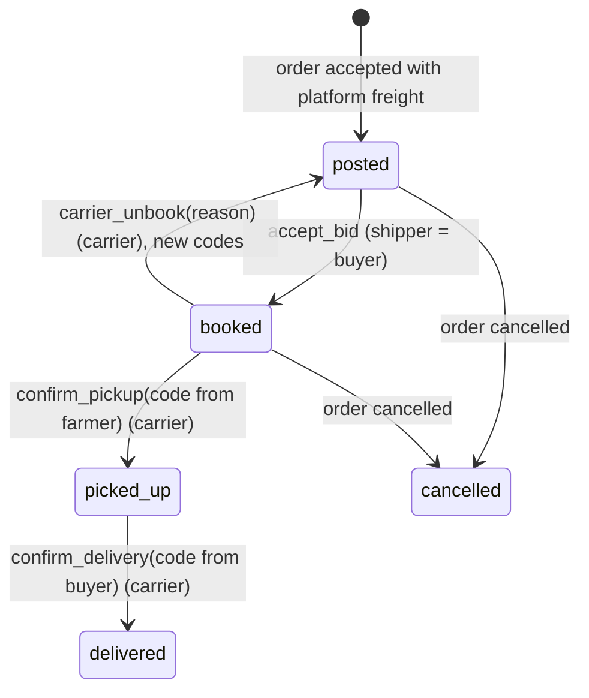
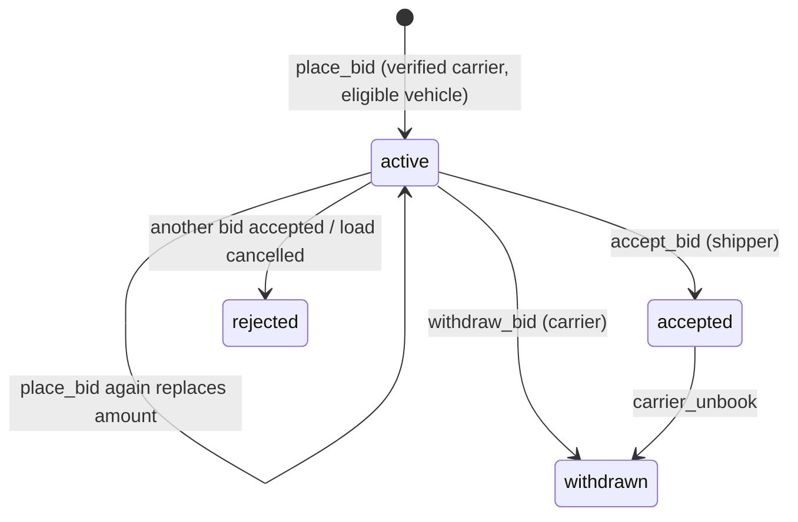
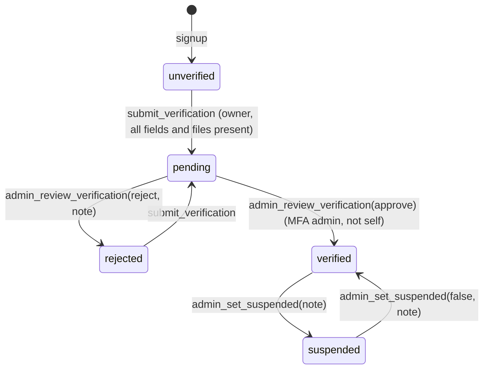

# State machines

Every transition below is one RPC in `supabase/migrations`. Anything not listed is rejected by the database. Tests: `supabase/tests/database/02_order_to_delivery.test.sql`.

## Order

| Transition | Actor | Guard | Side effects |
|---|---|---|---|
| place | verified buyer | listing published and in window; `min_order_kg ≤ qty ≤ available_kg`; own delivery location unless buyer picks up; one pending order per buyer per listing | price snapshot, `subtotal_cop` computed, `expires_at = now() + 24h` |
| accept | the order's farmer | pending, not expired, stock still available (row lock on listing), pickup date for platform | `available_kg -= qty`; listing `sold_out` when what's left is under the minimum; platform: load posted with fresh codes |
| reject | the order's farmer | pending, reason required | none |
| cancel (pending) | the buyer | pending | none |
| cancel (accepted) | buyer or farmer | load not picked up yet, reason required | stock returned (listing back to `published` if it was sold out and still in window), load cancelled, bids rejected |
| dispatch | the farmer | accepted, not platform | none |
| receipt | the buyer | `delivered`, or `in_transit` for non-platform | `completed_at` |

## Listing

Invariants: `0 ≤ available_kg ≤ quantity_kg`; editing `quantity_kg` moves `available_kg` by the same delta and can't go below what's sold; `municipality_code` always equals the farm's; only drafts that were never published can be deleted.

## Load (freight)

Invariants: `carrier_id`, `vehicle_id`, `agreed_rate_cop` are set exactly when status is booked, picked_up or delivered; one load per order; codes regenerate on unbook; 5 wrong codes lock the load until an admin steps in.

## Bid

Vehicle eligibility: owned by the bidder, active, verified, capacity ≥ load weight, body type matches when the load requires one, SOAT valid through `deliver_by`.

## Verification (people)

PII in `profile_private` and files in `kyc/{uid}/` are editable only while `unverified` or `rejected`. `submit_verification()` needs legal name, document type and number, phone, a `document` file and, for carriers, a `license` file; otherwise `VERIFICATION_INCOMPLETE` with the missing fields in `DETAIL` (S1-02).
